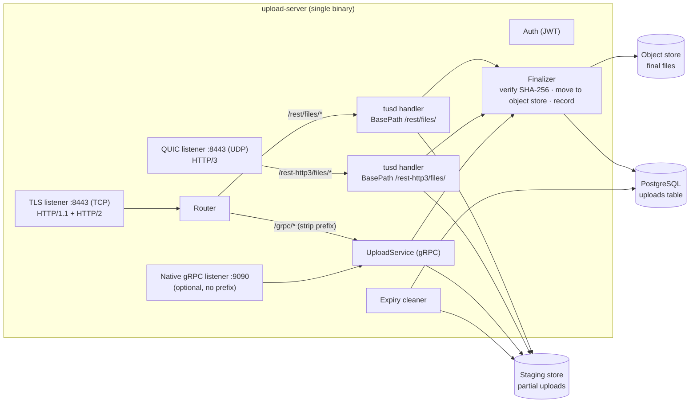

# Requirements — Sensor Upload Server

> **Audience:** an AI coding agent (or developer) implementing the server.
> **Companion document:** `sensor-upload-integration.md` is the client-facing contract. The server **must** conform to it exactly. If this document and the contract conflict, the contract wins; flag the conflict in the README.

---

## 0. Instructions for the Agent

1. Read this whole document and `sensor-upload-integration.md` before writing code.
2. **Verify every third-party API against its current official docs or source** (tusd v2, quic-go, grpc-go, pgx, etc.). Do not rely on memory for function names or config fields. Pin exact versions in `go.mod`.
3. Work in the milestone order in §13. Each milestone must build, pass its tests, and be committed before starting the next.
4. Follow idiomatic Go (Effective Go): small packages, explicit errors with `%w` wrapping, `context.Context` as the first parameter, no global mutable state, no `panic` in request paths.
5. When a requirement is ambiguous, choose the simplest option that satisfies the contract, and record the decision in `docs/decisions.md` (one line per decision: what, why).
6. Do not add features not listed here. List ideas under "Future work" in the README instead.

---

## 1. Purpose and Scope

Build a single Go service that receives files (photo, audio, video) from field sensors over unreliable links, using three protocols with identical semantics:

| Endpoint | Protocol | Transport |
|---|---|---|
| `/rest/files/` | tus 1.0 | HTTPS over TCP (HTTP/1.1 and HTTP/2) |
| `/rest-http3/files/` | tus 1.0 | HTTP/3 over QUIC (UDP) |
| `/grpc/upload.v1.UploadService/*` | gRPC | HTTP/2 over TCP |

The service is used both as an **experiment** (to compare protocols under bad network conditions) and as the **basis for production ingest**, so correctness and durability matter more than performance.

**In scope:** upload endpoints, auth, durable partial uploads, integrity verification, deduplication, finalization to object storage, metadata recording, expiry cleanup, observability, a test client, and a network-impairment test harness.

**Out of scope:** AI classification, dashboards, device provisioning UI, token issuance service (a dev-only CLI is in scope), multi-region deployment.

---

## 2. Tech Stack

| Concern | Choice |
|---|---|
| Language | Go (latest stable), modules |
| tus | `github.com/tus/tusd/v2` used **as a library** (`pkg/handler`, `pkg/filestore`, `pkg/s3store`, a locker package) |
| HTTP/3 | `github.com/quic-go/quic-go/http3` |
| gRPC | `google.golang.org/grpc`, `google.golang.org/protobuf`; codegen with `buf` |
| Database | PostgreSQL 16 via `github.com/jackc/pgx/v5`; migrations with `goose` or `golang-migrate` |
| Object storage | Local filesystem (dev) and S3-compatible (MinIO in dev, AWS S3 in prod) via AWS SDK for Go v2 |
| JWT | `github.com/golang-jwt/jwt/v5` |
| Logging | `log/slog`, JSON handler |
| Metrics | `github.com/prometheus/client_golang` |
| Config | Environment variables (no config framework required) |
| Tests | `testing`, `testify` (optional), `testcontainers-go` for Postgres and MinIO |
| Containers | Docker + Docker Compose |

---

## 3. Architecture



### Key design points

- **One finalizer** shared by all protocols: protocol code only receives bytes; verification, dedup, storage move and DB writes live in `internal/finalize`.
- **Two tusd handler instances** (one per base path) share the same staging store and locker. An upload created on one path is not resumable on the other (documented in the contract).
- **gRPC prefix:** on the TLS TCP listener, requests with path prefix `/grpc/` and `Content-Type: application/grpc*` are routed to `grpc.Server.ServeHTTP` after stripping `/grpc`. The optional native listener on `:9090` serves the same service without prefix (for benchmarking native gRPC transport vs `ServeHTTP`).
- **Same port, TCP and UDP:** TLS TCP and QUIC both bind `:8443` (TCP and UDP respectively).

---

## 4. Repository Layout

```
upload-server/
├── cmd/
│   ├── server/            # main: config, wiring, graceful shutdown
│   ├── uploader/          # test client: rest | rest-http3 | grpc
│   └── devtoken/          # dev-only: issue device JWTs
├── internal/
│   ├── config/            # env parsing + validation
│   ├── auth/              # JWT verification, device_id extraction
│   ├── meta/              # metadata model, validation, tus Upload-Metadata parsing
│   ├── tusapi/            # tusd handler construction + callbacks
│   ├── grpcapi/           # UploadService implementation
│   ├── staging/           # gRPC partial-upload storage (append, fsync, info)
│   ├── finalize/          # shared completion pipeline
│   ├── objstore/          # interface + local and S3 implementations
│   ├── db/                # pgx queries, migrations
│   ├── cleanup/           # expiry job
│   ├── httpx/             # router, gRPC prefix strip, middleware
│   └── obs/               # logging + metrics
├── proto/upload/v1/upload.proto
├── migrations/
├── deploy/
│   ├── docker-compose.yml # server, postgres, minio, netem client
│   └── netem/             # network profiles + scripts
├── test/e2e/
├── docs/decisions.md
├── buf.yaml, buf.gen.yaml
├── Makefile
└── README.md
```

---

## 5. Functional Requirements

### FR-1 Common metadata

Every upload carries these fields (tus: `Upload-Metadata`; gRPC: `InitRequest`).

| Field | Rule |
|---|---|
| `device_id` | Required; `^[A-Za-z0-9][A-Za-z0-9-]{2,63}$`, lowercased by the server; must equal JWT `device_id` claim |
| `sha256` | Required; 64 lowercase hex chars |
| `filename` | Required; 1–255 chars; no `/` or `\`; stored as-is, never used as a path |
| `content_type` | Required; must be in the allow-list (FR-1a) |
| `captured_at` | Required; RFC 3339 with offset; not more than 24 h in the future |
| `priority` | Required; integer 1–4 |
| size | `Upload-Length` / `InitRequest.size`; 1 byte to `MAX_FILE_BYTES` |

**FR-1a Content-type allow-list** (configurable): `image/jpeg`, `image/png`, `image/webp`, `image/avif`, `audio/wav`, `audio/x-wav`, `audio/flac`, `audio/ogg`, `audio/opus`, `video/mp4`, `video/quicktime`, `application/json`, `text/csv`.

Validation failures → tus `400` / gRPC `INVALID_ARGUMENT`, with a message naming the field.

### FR-2 Authentication

- Bearer JWT in `Authorization` (tus) or `authorization` metadata (gRPC) on **every** request.
- Algorithms: `ES256` (prod) and `HS256` (dev only, enabled by config flag). Reject `none` and anything else.
- Required claims: `device_id`, `exp`. Optional: `iat`, `nbf`. Allowed clock skew: 120 s.
- Missing/invalid token → `401` / `UNAUTHENTICATED`. `device_id` mismatch with metadata → `403` / `PERMISSION_DENIED`.
- For tus `PATCH`/`HEAD`/`DELETE`, the token's `device_id` must equal the upload's stored `device_id`; otherwise `403` (do not reveal whether the upload exists to other devices: return `404` if the IDs differ — pick one and record it in `docs/decisions.md`).
- `cmd/devtoken` issues HS256/ES256 tokens for a given `device_id` and TTL.

### FR-3 Deduplication

- On create (tus `POST`, gRPC `Init`): if an upload with the same `sha256` is already `completed`, reject:
  - tus: HTTP **461**, body `already exists`
  - gRPC: `ALREADY_EXISTS`
- gRPC `Init` with the same `sha256` + `device_id` and an **in-progress** upload: return the existing `upload_id` and its `committed_offset` (idempotent resume).
- tus `POST` with an in-progress upload for the same `sha256`: create a new upload (tus clients resume via their stored URL); the older one expires normally. Record this decision.
- Enforce at DB level: unique index on `sha256` where `status = 'completed'`.

### FR-4 tus endpoints (`/rest/files/`, `/rest-http3/files/`)

- Implement exactly the contract in `sensor-upload-integration.md` §2–3: tus 1.0 core + creation, termination, expiration extensions. `OPTIONS` must advertise them (`Tus-Extension`), plus `Tus-Max-Size`.
- `Location` header must use the base path the request arrived on.
- Use tusd callbacks:
  - **Pre-create:** auth, metadata validation, dedup check (FR-3), size limit. Insert DB row with `status = 'uploading'`.
  - **Pre-finish (before the final `204`):** run the finalizer synchronously. On SHA-256 mismatch return HTTP **460**; on duplicate-race return **461**. The client must not see `204` for the last chunk unless finalization succeeded.
  - **Terminate:** mark DB row `cancelled`.
- Use a locker so concurrent `PATCH` requests on the same upload are serialized (`409`/`423` per tusd behavior).
- `Upload-Expires` header must reflect `INCOMPLETE_TTL`.
- HTTP/1.1 and HTTP/2 must both work on the TCP listener.

### FR-5 HTTP/3 endpoint (`/rest-http3/files/`)

- Served by `http3.Server` on UDP `LISTEN_ADDR`, same TLS certificate as TCP.
- Same tusd semantics as FR-4, own handler instance with `BasePath = /rest-http3/files/`.
- The TCP listener must respond `404` to `/rest-http3/*` (to make misrouted clients obvious) — or, if simpler, serve it too; record the choice.
- Responses on the TCP listener should include an `Alt-Svc` header advertising `h3` on the configured port (informational only).
- Configure QUIC idle timeout (`QUIC_IDLE_TIMEOUT`, default 60 s) and keep-alive (`QUIC_KEEPALIVE`, default 20 s).

### FR-6 gRPC service (`/grpc` prefix)

- `.proto` exactly as in the contract §4; package `upload.v1`; Go package path under the module.
- **Init:** validate (FR-1), auth (FR-2), dedup (FR-3), create staging file, return `upload_id` (UUIDv7), `committed_offset`, `max_chunk_bytes` (`GRPC_MAX_CHUNK_BYTES`, default 262144).
- **Upload (bidi stream):**
  - Every `Chunk` must carry `upload_id`; all chunks in one stream must have the same `upload_id`, else `INVALID_ARGUMENT`.
  - `offset` must equal the current committed offset, else `FAILED_PRECONDITION` (message includes the expected offset).
  - `len(data)` ≤ `max_chunk_bytes` and `offset + len(data)` ≤ size, else `INVALID_ARGUMENT`.
  - Write → `fsync` → update committed offset (staging info + DB) → send `Ack{committed_offset}`. **Never ack before fsync.**
  - Ack frequency: every chunk by default; configurable `GRPC_ACK_EVERY_N` for the experiment.
  - When the final byte is committed, run the finalizer; send `Ack{complete: true}` on success, `DATA_LOSS` on SHA-256 mismatch, `ALREADY_EXISTS` on dedup race. Then close the stream.
  - Only one active stream per `upload_id`; a second concurrent stream gets `ABORTED`.
- **Status:** return committed offset, size, complete flag; `NOT_FOUND` if unknown or expired.
- **Cancel:** delete staging data, mark `cancelled`.
- Server keepalive: `Time=30s`, `Timeout=10s`; enforcement policy `MinTime=10s`, `PermitWithoutStream=true`.
- Max receive message size: `max_chunk_bytes + 64 KiB`.
- Prefix routing as described in §3; the native listener (`GRPC_NATIVE_ADDR`, empty = disabled) serves without prefix.

### FR-7 Staging (partial uploads)

- tus: tusd `filestore` under `STAGING_DIR/tus` (dev) or `s3store` (configurable). Note for the agent: `s3store` has part-size constraints — document how they interact with small client chunks.
- gRPC: `STAGING_DIR/grpc/{upload_id}.bin` + `{upload_id}.json` (info: metadata, size, committed offset). Writes use `WriteAt` at the committed offset; `fsync` the file before acking.
- On restart, gRPC uploads must be resumable from the last acked offset (offset from DB is authoritative; truncate the `.bin` to it on resume).

### FR-8 Finalizer (shared)

Input: protocol, upload reference, staging reader, metadata. Steps, in order:

1. Stream the staged file through SHA-256; compare with metadata `sha256`. Mismatch → mark row `failed_checksum`, delete staging data, return checksum error.
2. Compute final key: `{device_id}/{yyyy}/{mm}/{dd}/{sha256}{ext}` using `captured_at` (UTC) and an extension derived from `content_type`.
3. Upload to object store (multipart for large files in S3 mode). Must be idempotent: if the key already exists with the same size, treat as success.
4. In one DB transaction: set `status = 'completed'`, `storage_key`, `completed_at`. A unique-violation on `sha256` → return duplicate error (race between protocols).
5. Delete staging data.
6. Emit log + metrics. (Future: publish an event; leave an interface `Notifier` with a no-op implementation.)

Finalization must be safe to retry if the process crashes between steps.

### FR-9 Expiry cleanup

- Background job every `CLEANUP_INTERVAL` (default 1 h).
- Uploads with `status = 'uploading'` and `updated_at` older than `INCOMPLETE_TTL` (default 7 d): delete staging data (both tus and gRPC), set `status = 'expired'`.
- Must not touch uploads currently locked/streaming.
- Requests on an expired tus upload return `410` (or `404`); gRPC returns `NOT_FOUND`.

### FR-10 Health and admin

- `GET /healthz` → `200` if the process is up.
- `GET /readyz` → `200` only if Postgres, staging dir and object store are reachable.
- Served on `METRICS_ADDR` together with `/metrics`, not on the public listener.

---

## 6. Database

```sql
CREATE TABLE uploads (
    id               UUID PRIMARY KEY,              -- UUIDv7
    protocol         TEXT NOT NULL CHECK (protocol IN ('rest','rest-http3','grpc')),
    upload_ref       TEXT NOT NULL,                 -- tus ID or gRPC upload_id
    device_id        TEXT NOT NULL,
    sha256           CHAR(64) NOT NULL,
    size_bytes       BIGINT NOT NULL,
    committed_bytes  BIGINT NOT NULL DEFAULT 0,
    filename         TEXT NOT NULL,
    content_type     TEXT NOT NULL,
    captured_at      TIMESTAMPTZ NOT NULL,
    priority         SMALLINT NOT NULL CHECK (priority BETWEEN 1 AND 4),
    status           TEXT NOT NULL CHECK (status IN
                       ('uploading','completed','failed_checksum','cancelled','expired')),
    storage_key      TEXT,
    resume_count     INT NOT NULL DEFAULT 0,        -- times the client resumed
    created_at       TIMESTAMPTZ NOT NULL DEFAULT now(),
    updated_at       TIMESTAMPTZ NOT NULL DEFAULT now(),
    completed_at     TIMESTAMPTZ
);

CREATE UNIQUE INDEX uploads_sha256_completed ON uploads (sha256) WHERE status = 'completed';
CREATE UNIQUE INDEX uploads_protocol_ref     ON uploads (protocol, upload_ref);
CREATE INDEX        uploads_status_updated   ON uploads (status, updated_at);
CREATE INDEX        uploads_device_created   ON uploads (device_id, created_at DESC);
```

- `committed_bytes` for tus may be updated on each `PATCH` (via tusd progress/post-receive hooks) or only at completion; choose and record. For gRPC it is updated on every ack.
- `resume_count` increments on every tus `HEAD` after creation and every gRPC `Init`/`Status` that returns an offset > 0.

---

## 7. Error Mapping

| Condition | tus HTTP | gRPC code |
|---|---|---|
| Invalid metadata / chunk too big | 400 | `INVALID_ARGUMENT` |
| Missing / invalid token | 401 | `UNAUTHENTICATED` |
| `device_id` mismatch | 403 | `PERMISSION_DENIED` |
| Unknown upload | 404 | `NOT_FOUND` |
| Offset mismatch | 409 | `FAILED_PRECONDITION` |
| Expired upload | 410 | `NOT_FOUND` |
| File too large | 413 | `INVALID_ARGUMENT` |
| Concurrent access to same upload | 423 (tusd locker) | `ABORTED` |
| SHA-256 mismatch | **460** | `DATA_LOSS` |
| Already completed (dedup) | **461** | `ALREADY_EXISTS` |
| Storage / DB failure | 500 | `INTERNAL` |
| Shutting down | 503 | `UNAVAILABLE` |

Error bodies (tus) and status messages (gRPC) are short, human-readable, and never include stack traces, file paths or other devices' data.

---

## 8. Configuration (environment variables)

| Variable | Default | Description |
|---|---|---|
| `LISTEN_ADDR` | `:8443` | TLS TCP + QUIC UDP |
| `GRPC_NATIVE_ADDR` | *(empty)* | Optional native gRPC listener |
| `METRICS_ADDR` | `:9100` | `/metrics`, `/healthz`, `/readyz` |
| `TLS_CERT_FILE`, `TLS_KEY_FILE` | — | Required |
| `DATABASE_URL` | — | Required |
| `STAGING_DIR` | `./data/staging` | Partial uploads |
| `TUS_STAGING` | `file` | `file` or `s3` |
| `OBJSTORE` | `local` | `local` or `s3` |
| `OBJSTORE_LOCAL_DIR` | `./data/objects` | When `local` |
| `S3_ENDPOINT`, `S3_REGION`, `S3_BUCKET`, `S3_ACCESS_KEY`, `S3_SECRET_KEY`, `S3_FORCE_PATH_STYLE` | — | When `s3` (MinIO needs path style) |
| `MAX_FILE_BYTES` | `524288000` | 500 MB |
| `INCOMPLETE_TTL` | `168h` | Expiry for incomplete uploads |
| `CLEANUP_INTERVAL` | `1h` | Cleanup job period |
| `GRPC_MAX_CHUNK_BYTES` | `262144` | Returned in `InitResponse` |
| `GRPC_ACK_EVERY_N` | `1` | Ack frequency |
| `QUIC_IDLE_TIMEOUT` | `60s` | |
| `QUIC_KEEPALIVE` | `20s` | |
| `JWT_ALGS` | `ES256` | Comma list; `HS256` allowed only if `DEV_MODE=true` |
| `JWT_PUBLIC_KEY_FILE` | — | For ES256 |
| `JWT_HMAC_SECRET` | — | For HS256 (dev) |
| `CONTENT_TYPES` | see FR-1a | Override allow-list |
| `DEV_MODE` | `false` | Enables HS256 and verbose logs |
| `LOG_LEVEL` | `info` | |
| `SHUTDOWN_TIMEOUT` | `30s` | Graceful drain |

Config is validated at startup; invalid config exits non-zero with a clear message.

---

## 9. Non-Functional Requirements

| ID | Requirement |
|---|---|
| NFR-1 Durability | No acked byte is lost on process crash (gRPC: fsync before ack; tus: rely on tusd store semantics, verify with a kill test). |
| NFR-2 Memory | Server memory must not scale with file size: stream everything, never buffer a whole file. Peak RSS under 50 concurrent uploads of 200 MB < 300 MB. |
| NFR-3 Concurrency | At least 200 concurrent in-progress uploads on a 2 vCPU / 2 GB instance. |
| NFR-4 Timeouts | tus: `ReadHeaderTimeout` 15 s, per-request read timeout 120 s, idle 120 s. gRPC: per-stream idle 120 s. No unbounded waits. |
| NFR-5 Graceful shutdown | On SIGTERM: stop accepting, let in-flight chunks finish up to `SHUTDOWN_TIMEOUT`, flush staging, close DB. |
| NFR-6 Security | TLS 1.2+ on TCP (TLS 1.3 on QUIC); no plaintext listeners except metrics; path traversal impossible (no client input in filesystem paths except validated `upload_id`/`sha256`). |
| NFR-7 Portability | Runs on Linux amd64 and arm64; single static binary; container image < 50 MB (distroless or scratch). |

---

## 10. Observability

**Logging (slog JSON)** — one line per request/stream event with: `protocol`, `upload_ref`, `device_id`, `method`, `offset_before`, `offset_after`, `bytes`, `duration_ms`, `status`, `error`. Do not log tokens or file contents.

**Metrics (Prometheus)**, all labelled by `protocol`:

| Metric | Type |
|---|---|
| `upload_started_total` | counter |
| `upload_completed_total` | counter |
| `upload_failed_total{reason}` | counter (`checksum`, `duplicate`, `expired`, `cancelled`, `internal`) |
| `upload_resumes_total` | counter |
| `upload_bytes_received_total` | counter |
| `upload_chunk_bytes` | histogram |
| `upload_duration_seconds` (create → complete) | histogram |
| `upload_finalize_seconds` | histogram |
| `upload_in_progress` | gauge |
| `grpc_stream_resets_total` | counter |

---

## 11. Test Client (`cmd/uploader`)

Purpose: integration testing and the protocol experiment.

```
uploader -protocol rest|rest-http3|grpc -url https://host:8443 -token $T \
         -file ./sample.flac -device bioac-0142 -priority 3 \
         -chunk 262144 -retries 50 -backoff-max 30s -report out.csv
```

- Implements the client behavior from `sensor-upload-integration.md` §5 (compute SHA-256, create, resume via `HEAD`/`Status`, backoff with jitter, persist state in a local SQLite or JSON file so a killed client resumes).
- Supports `-dir` to upload many files and `-concurrency N`.
- `-report` writes one CSV row per file: `protocol, file, size, chunk, duration_ms, attempts, resumes, bytes_sent_total, bytes_resent, result`.
- `bytes_sent_total` counts payload bytes actually sent (including re-sends), so overhead can be computed.

---

## 12. Testing

### Unit
- Metadata parsing/validation (including tus base64 parsing and malformed headers).
- JWT verification (valid, expired, wrong alg, `none`, mismatched `device_id`).
- Final key generation and extension mapping.
- gRPC offset/size/chunk validation.

### Integration (`testcontainers-go`: Postgres + MinIO)
- tus full upload, both base paths; HTTP/1.1, HTTP/2 and HTTP/3 clients.
- gRPC full upload via `/grpc` prefix and via native listener.
- Resume after client disconnect mid-chunk, for every protocol.
- Resume after **server restart** mid-upload, for every protocol (NFR-1).
- SHA-256 mismatch → 460 / `DATA_LOSS`, staging cleaned.
- Duplicate → 461 / `ALREADY_EXISTS`; race: same file via two protocols concurrently → exactly one `completed` row.
- Auth failures and cross-device access.
- Expiry job removes stale uploads and later requests get 410 / `NOT_FOUND`.
- Concurrent `PATCH` on the same tus upload; second gRPC stream on same `upload_id` → `ABORTED`.

### Network-impairment harness (`deploy/netem`)
- Docker Compose service running the `uploader` with `NET_ADMIN`, applying `tc netem` (works for both TCP and UDP/QUIC; do not use Toxiproxy, which is TCP-only).
- Profiles (script per profile):

| Profile | Rate | Delay (± jitter) | Loss | Link-down events |
|---|---|---|---|---|
| `good-4g` | 5 Mbit | 50 ms ± 10 | 0.1% | none |
| `weak-4g` | 256 kbit | 300 ms ± 100 | 3% | 10 s down every ~2 min |
| `leo-sat` | 2 Mbit | 60 ms ± 20 | 1% | link off after 10 min |
| `very-poor` | 64 kbit | 800 ms ± 200 | 10% | 5 s down every ~30 s |

- `make experiment` runs protocol × profile × file size (50 KB, 2 MB, 20 MB, 200 MB) × chunk (64 KB, 256 KB) × 5 repetitions, and merges all CSVs into `results/summary.csv` with median and p95 per combination.

### Coverage
- ≥ 80% line coverage on `internal/meta`, `internal/auth`, `internal/finalize`, `internal/grpcapi`, `internal/staging`.

---

## 13. Milestones

| # | Milestone | Done when |
|---|---|---|
| M1 | Skeleton: config, logging, metrics/health server, TLS listener, graceful shutdown, Docker Compose (Postgres, MinIO), migrations | `make up` starts everything; `/readyz` green |
| M2 | Auth + metadata validation + `devtoken` | Unit tests pass |
| M3 | Finalizer + object store (local + S3) + DB repository | Unit + integration tests pass |
| M4 | tus on `/rest/files/` with all callbacks, dedup, 460/461 | Integration tests (incl. server restart) pass |
| M5 | HTTP/3 on `/rest-http3/files/` | HTTP/3 integration tests pass |
| M6 | gRPC service, staging, prefix routing, native listener | gRPC integration tests (incl. restart) pass |
| M7 | Expiry cleanup | Cleanup tests pass |
| M8 | `cmd/uploader` with resume + CSV report | Uploads succeed on all three protocols |
| M9 | Netem harness + `make experiment` + summary | `results/summary.csv` produced for all profiles |
| M10 | README + `docs/decisions.md` + final review | Acceptance criteria (§15) all checked |

---

## 14. Deliverables

- Source code in the layout of §4, building with `go build ./...` and passing `go vet` and `staticcheck`.
- `Makefile` targets: `build`, `test`, `test-integration`, `proto`, `up`, `down`, `devcert` (self-signed cert for local dev), `experiment`, `lint`.
- `Dockerfile` (multi-stage, distroless/static, non-root user).
- `deploy/docker-compose.yml` with server, Postgres, MinIO, and the netem uploader.
- `README.md`: quick start, config table, how to run each test level, how to read experiment results, known limitations, future work.
- `docs/decisions.md`: every judgment call made during implementation.

---

## 15. Acceptance Criteria

- [ ] A 200 MB file uploads successfully over each of the three endpoints using `cmd/uploader`.
- [ ] Killing the **client** mid-upload and restarting it resumes from the server offset on all three endpoints, with re-sent bytes ≤ one chunk.
- [ ] Killing the **server** mid-upload and restarting it allows resume with no data loss on all three endpoints.
- [ ] A corrupted upload (wrong `sha256`) is rejected with 460 / `DATA_LOSS` and leaves no file in the object store.
- [ ] Uploading an already-completed file returns 461 / `ALREADY_EXISTS`; concurrent duplicate uploads produce exactly one stored object and one `completed` row.
- [ ] Requests with a missing, expired, wrongly-signed or `alg: none` token are rejected.
- [ ] A device cannot read, resume or cancel another device's upload.
- [ ] Incomplete uploads older than `INCOMPLETE_TTL` are removed by the cleanup job.
- [ ] Server RSS stays under the NFR-2 limit during the concurrency test.
- [ ] `make experiment` completes for all profiles and produces `results/summary.csv`.
- [ ] Behavior matches `sensor-upload-integration.md` for every endpoint, header, status code and gRPC code; any deviation is listed in the README.
